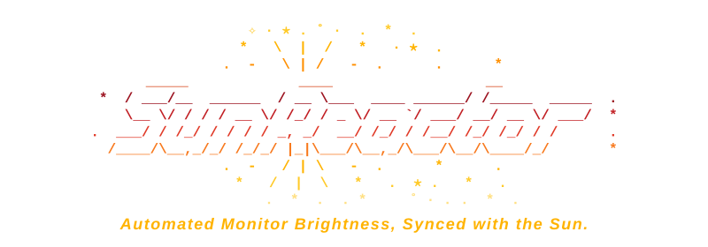
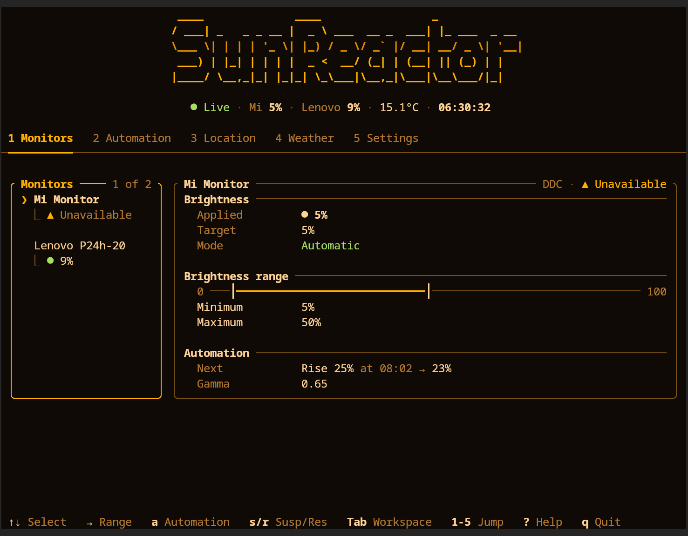
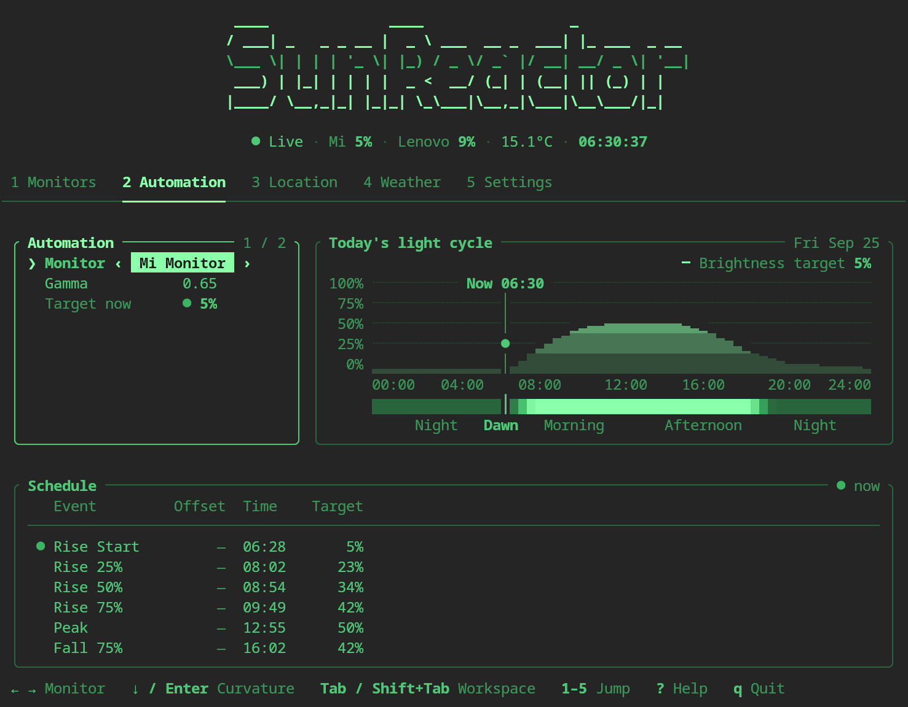
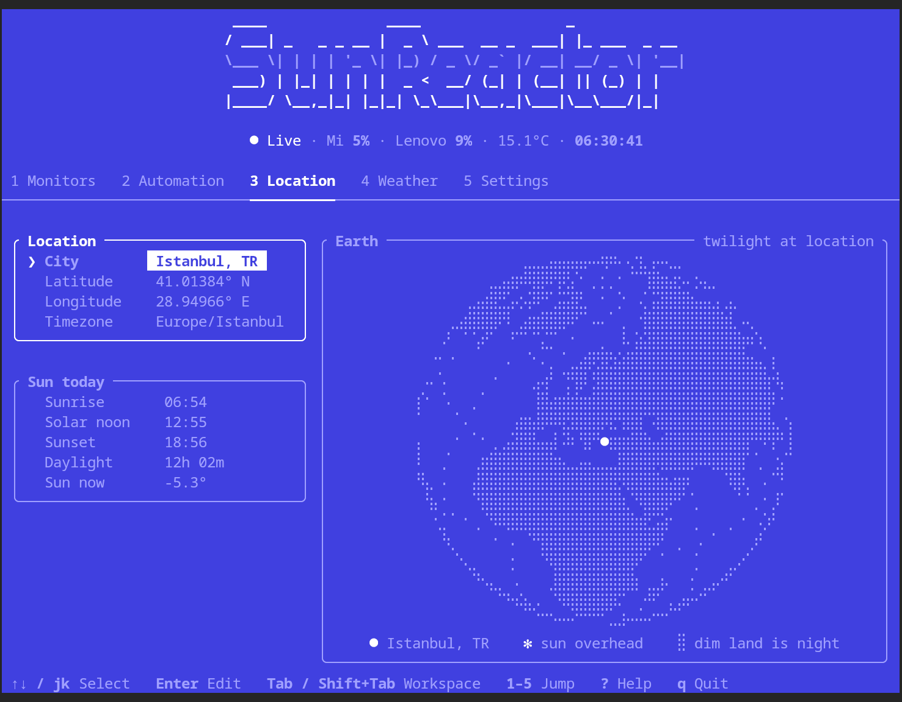
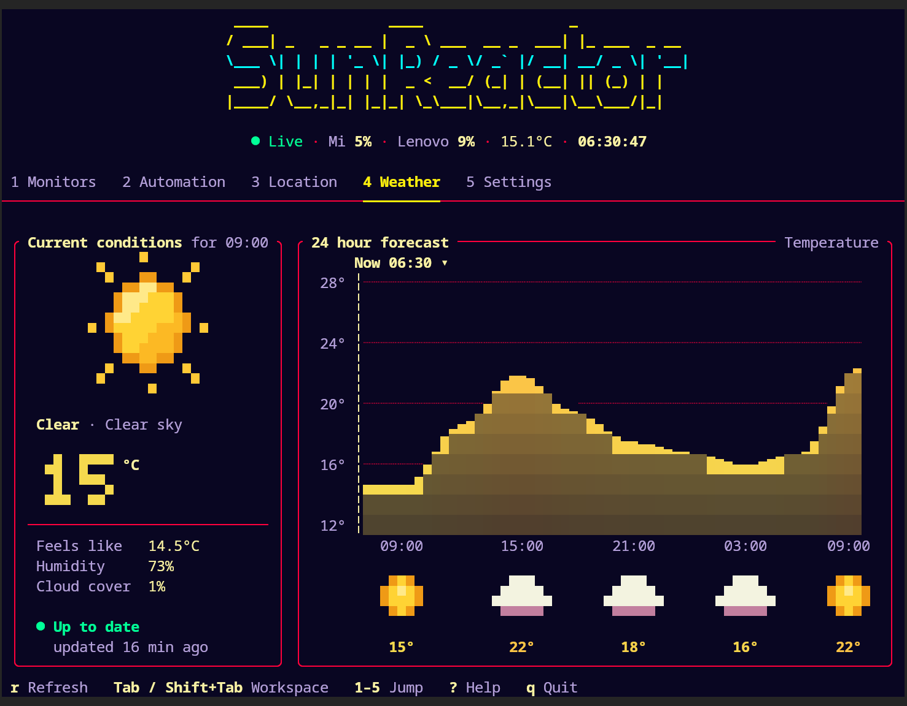
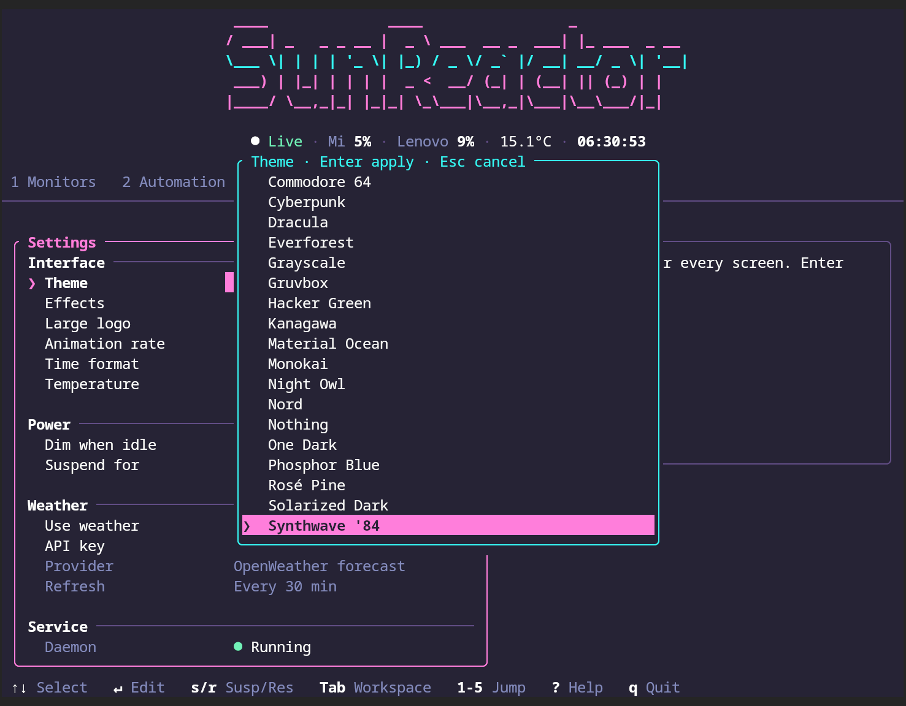

<div align="center">
  
  <br/>
  <a href="https://ratatui.rs"></a>
  
  
  
</div>

<br/>

**SunReactor** is a background daemon that sets display brightness from the sun's elevation at your location. It runs as an unprivileged user service, written in Rust. Weather is an optional, bounded correction on top of the solar curve. It drives external monitors over DDC/CI and laptop panels through backlight devices, and it ships with a terminal UI, a CLI and a KDE Plasma 6 widget.

---

## // PREVIEW (TUI WORKSPACES & THEMES)

SunReactor features an immediate-style, terminal UI built with `ratatui` with 40 built-in themes (and your own TOML themes), a daylight globe and live device status:

<div align="center">
  
  
  <br/>
  
  
  
</div>
<br/>

---

## // RECENT CHANGES

Details are in [CHANGELOG.md](CHANGELOG.md). The main points:

**Next release (0.13.0)**
- Themes are TOML data shared by the terminal UI and the Plasma widget. 40 are built in; you can add your own in `~/.config/sunreactor/themes/` ([docs/THEMES.md](docs/THEMES.md)).
- New `sunreactorctl theme` commands, and new IPC requests (`list_themes`, `get_theme`, `day_curve`) used by the widget.
- The Plasma widget was rewritten around that theme data: see [Plasma widget](#-plasma-widget).

**0.12.0**
- Monitor power state is read from DRM sysfs before DDC commands are sent, so sleeping or disconnected displays are skipped.
- A periodic hardware probe and a short fast-retry window after wake re-apply the target brightness when the compositor resets it.
- Failures are tracked per display with exponential backoff (5 s up to 300 s), so one slow monitor does not delay the others.
- Each daemon tick serves a limited number of IPC requests (16, or 8 ms), so a busy client cannot disturb fades.
- IPC frames are newline-delimited with a 64 KiB limit and read/write deadlines.
- Config reloads are validated before they are applied, and a bad edit is rolled back.
- Terminal UI split into Monitors, Automation, Location, Weather and Settings workspaces.
- First version of the Plasma widget.

---

## // ARCHITECTURE

The runtime is built around failure isolation and non-blocking hardware access, with few dependencies.

```text
 ┌────────────────────────────────────────────────────────────────────────┐
 │                         SunReactor Core Daemon                         │
 │                                                                        │
 │  ┌───────────────────────┐              ┌───────────────────────────┐  │
 │  │ Solar Ephemeris Math  │              │ Weather Client (Forecast) │  │
 │  │ Deterministic Curves  │              │ Bounded Attenuation Coeff │  │
 │  └───────────┬───────────┘              └─────────────┬─────────────┘  │
 │              │                                        │                │
 │              └───────────────────┬────────────────────┘                │
 │                                  ▼                                     │
 │                     ┌─────────────────────────┐                        │
 │                     │ Target Policy Evaluator │                        │
 │                     └────────────┬────────────┘                        │
 │                                  │                                     │
 │  ┌───────────────────────────────┴───────────────────────────────┐     │
 │  │         Hardware Truth Reconciliation & Probe Engine          │     │
 │  │  - DRM Sysfs Power Gate (/sys/class/drm/*/dpms, status)       │     │
 │  │  - Connector Direct Bus Addressing (Zero DDC scan bus locks)  │     │
 │  │  - Readback Verification (Prevents compositor/KWin thrashing) │     │
 │  │  - Per-Device Exponential Backoff (5s -> 300s)                │     │
 │  └───────────────┬───────────────────────────────┬───────────────┘     │
 │                  │                               │                     │
 └──────────────────┼───────────────────────────────┼─────────────────────┘
                    ▼                               ▼
       ┌────────────────────────┐      ┌─────────────────────────┐
       │ External Monitors (DDC)│      │ Internal Laptop Panels  │
       │  I2C / ddcutil bus     │      │   Linux sysfs backlight │
       └────────────────────────┘      └─────────────────────────┘
```

### 1. Hardware state and monitor wake
- **DRM Kernel State Gating:** Before dispatching DDC transactions over I2C, the daemon queries connector status directly from kernel DRM attributes (`/sys/class/drm/*/status` and `dpms`). If a display is in standby, suspend, or disconnected, hardware writes are skipped immediately—eliminating I2C bus locks and timeout penalties.
- **Signal-Independent Probe Schedule:** Desktop wake notifications (e.g. logind, DRM uevents) can be dropped or skipped during compositor transitions. SunReactor implements a scheduled hardware probe loop (`runtime/wake.rs`). Every `probe_seconds` (default: 15s), the daemon directly verifies physical monitor registers.
- **Fast-Recovery Windows:** When a monitor returns from an unreachable state, a 60-second fast-probe window (2-second pulses) activates. This immediately counteracts compositor state restores (such as KWin's internal saved DDC cache) and locks the display back to the active astronomical curve.

### 2. Failures and backoff
- **Transient vs. Persistent Faults:** Hardware communication errors are isolated per monitor. Transient timeouts (busy DDC buses, hotplug debounce) and persistent device missing states are classified and tracked independently.
- **Exponential Backoff:** If a monitor fails to acknowledge a write or read, it enters per-device exponential backoff (`5s, 10s, 20s, ... 300s`). Healthy displays continue applying curve updates smoothly without being blocked or delayed by an unresponsive display.
- **Automatic Recovery:** When a degraded or disconnected monitor responds successfully, its backoff state is cleared immediately without requiring daemon restarts.

### 3. IPC limits
- **Bounded Main-Loop Quantum:** The daemon IPC subsystem accepts Unix domain socket connections through a cooperative drain quantum (maximum 16 accepted requests or 8ms wall-clock duration per loop tick). Incoming IPC traffic can never starve or desynchronize the core brightness fade ticks.
- **Strict Payload Boundaries:** Every IPC message is framed with newline-delimited JSON and limited to 64 KiB payload limit. Operation deadlines guard against lingering sockets and slow-read attacks.
- **Non-Destructive Socket Cleanup:** Stale socket cleanup validates file metadata and active listeners, preventing accidental unlinking of foreign runtime resources.

### 4. Fail-Safe Configuration & State Pruning
- **Atomic Config Reloads:** Live configuration reloads (`sunreactorctl reload-config` or TUI writebacks) validate schema integrity, monitor IDs, and boundary constraints before updating runtime state. If validation fails, previous active configurations remain in memory.
- **Automatic Stale State Pruning:** Whenever a display is removed from `config.toml`, orphan runtime backoff trackers and monitor override state are cleanly purged during bootstrap and reload cycles.

---

## // MATHEMATICAL FORMULATION

SunReactor computes target brightness deterministically without requiring constant network connectivity:

```text
        ☀ (Solar Noon) --> Max Brightness (DayPeak)
       /  \
     /      \ (Smooth transition via parametric gamma curve)
    /        \
- 0° (Horizon) -----------------------------------------------
                \
                  \ ☾ (Astronomical Night) --> Min Brightness (NightFloor)
```

1. **Normalized Solar Position ($t$):**
   $$t = \text{clamp}\left(\frac{\theta - \theta_{\text{night}}}{\theta_{\text{day}} - \theta_{\text{night}}}, 0, 1\right)$$
   Where $\theta$ represents the instantaneous solar elevation angle calculated from the local latitude, longitude, and UTC timestamp.

2. **Smoothstep Hermite Interpolation ($s(t)$):**
   $$s(t) = t^2 (3 - 2t)$$

3. **Per-Monitor Curvature Easing:**
   $$\text{Curve}(t) = [s(t)]^\gamma$$
   Where $\gamma$ is a user-tunable easing exponent configured independently per display (`transition_gamma`).

4. **Multi-Factor Clamped Projection:**
   $$\text{Brightness}_{\text{target}} = \text{clamp}\Big(\text{MinPct} + (\text{MaxPct} - \text{MinPct}) \cdot \text{Curve}(t) \cdot \text{Gain} \cdot W_{\text{mult}}, \;\text{MinPct}, \;\text{MaxPct}\Big)$$
   Where $W_{\text{mult}} \in [0.75, 1.0]$ is the bounded cloud-cover multiplier derived from OpenWeather forecast intervals.

---

## // ECOSYSTEM & INTEGRATIONS

### 1. Interactive Terminal UI (`sunreactorctl tui`)
- Full keyboard-driven navigation with browser-style shortcuts (`1`-`5` tabs, `Tab`/`Shift+Tab`).
- Real-time ASCII light cycle and 24-hour solar trajectory visualizer.
- Interactive orthographic globe with real-time solar terminator rendering.
- 40 built-in themes including Amber, Terminal, Commodore 64, Cyberpunk, Synthwave '84, Gruvbox, Nord, Tokyo Night, and Catppuccin Mocha; themes are shared with the Plasma widget and can be extended with user TOML files (see [Themes](#themes)).

### 2. Native KDE Plasma 6 Desktop Integration
A KDE Plasma 6 panel widget lives in [`plasma/`](plasma/). It shows the current brightness, the day curve and the weather, and lets you pause automation or set a manual brightness per display.
- Installation, settings and troubleshooting are in [Plasma widget](#-plasma-widget).

### 3. Scriptable Control CLI (`sunreactorctl`)
```bash
sunreactorctl status               # Inspect live daemon state, solar angles, and device topology
sunreactorctl discover             # Probe and identify all connected DDC and sysfs monitors
sunreactorctl set desk 75          # Apply a manual brightness override to a single monitor
sunreactorctl set --global 60      # Temporarily lock all displays to 60%
sunreactorctl suspend --minutes 90 # Pause brightness updates for 90 minutes
sunreactorctl resume               # Clear overrides and return to the active solar curve
sunreactorctl reload-config        # Atomically validate and reload config.toml
sunreactorctl theme list           # Built-in and user themes (* marks the configured one)
sunreactorctl theme set nord       # Set tui.theme and reload the daemon
```

---

## // INSTALLATION & COMPATIBILITY

### System Requirements
- **OS:** Linux (Kernel $\ge 5.15$, glibc $\ge 2.34$ or musl) or Windows 10/11.
- **Arch / CachyOS / Fedora / Debian / Ubuntu / openSUSE** fully qualified.
- **Hardware Backends:**
  - External Displays: `ddcutil` ($\ge 1.4.1$, recommended $\ge 2.2.0$) with user access to `/dev/i2c-*` (`uaccess` or `i2c` group).
  - Laptop Panels: Linux `sysfs` or `brightnessctl`.

### Quick Automated Installation
```bash
curl -sL https://raw.githubusercontent.com/arcanorca/SunReactor/main/install.sh | bash
```

*The installer verifies the release SHA-256 manifest and installs unprivileged binaries to `~/.local/bin`. When a systemd user manager is available, it also installs, enables, and starts `sunreactord.service`, then verifies that the daemon answers on IPC. Use `--no-service` to install without starting brightness automation.*

*From a clone, the installer also builds the Plasma widget when `plasmashell` and `kpackagetool6` are installed. `--no-plasma` skips it, `--with-plasma` tries anyway, and `--dry-run` prints the widget plan and changes nothing. See [Plasma widget](#-plasma-widget).*

### Building from Source (Optimized Native Profile)
```bash
git clone https://github.com/arcanorca/SunReactor.git
cd SunReactor

# Build with maximum CPU vectorization and locked dependencies
RUSTFLAGS="-C target-cpu=native" cargo build --release --locked

# Install binaries to ~/.local/bin
install -m 755 target/release/sunreactord target/release/sunreactorctl ~/.local/bin/

# Enable user daemon
mkdir -p ~/.config/systemd/user
cp contrib/systemd/sunreactord.service ~/.config/systemd/user/
systemctl --user daemon-reload
systemctl --user enable --now sunreactord.service
```

---

## // CONFIGURATION SPECIFICATION

The daemon configuration is stored in standard TOML format at `~/.config/sunreactor/config.toml`:

```toml
[daemon]
tick_seconds = 60
dry_run = false
desktop_idle_sync = false
apply_reassert_minutes = 2
ddc_timeout_seconds = 4
probe_seconds = 15

[location]
city = "Istanbul, TR"
latitude = 41.01384
longitude = 28.94966
timezone = "Europe/Istanbul"

[solar_policy]
twilight_elevation_start = -6.0
day_elevation_full = 20.0
use_adaptive_zenith = true
max_step_pct_per_tick = 6
min_write_delta_pct = 1

[[monitors]]
logical_id = "desk-primary"
backend = "ddc"
enabled = true
min_pct = 5
max_pct = 60
gain = 1.0
transition_gamma = 0.65
connector = "card1-DP-1"

[[monitors]]
logical_id = "laptop-internal"
backend = "backlight"
enabled = true
min_pct = 2
max_pct = 100
gain = 1.1
transition_gamma = 0.5
sysfs_path = "/sys/class/backlight/amdgpu_bl1"

[weather]
enabled = true
provider = "openweather"
api_key_env = "OPENWEATHER_API_KEY"
refresh_minutes = 30
min_multiplier = 0.75

[tui]
fps = 60
theme = "amber"        # any id or alias from `sunreactorctl theme list`
effects = "instrument"
show_logo = true
```

### Themes

Themes are data shared by the TUI and the Plasma widget. The 40 built-ins are
embedded in the binaries; user themes live in `~/.config/sunreactor/themes/<id>.toml`
(the file stem must equal `id`; a user file shadows a built-in with the same id).
`tui.theme` accepts any theme id or alias, including legacy names such as
`workbench` or `vfdhifi`; an unknown name fails `config validate` with the nearest matches.

The full authoring guide (every key, the family defaults, the widget's follow and pin model, the flagship skins and a worked example) is in [docs/THEMES.md](docs/THEMES.md).

A broken theme never stops automatic brightness: the daemon logs and skips
invalid theme files, falls back to the built-in theme of the same id (or
`amber`) and reports the reason as `theme_warning` in `sunreactorctl status`.
`sunreactorctl config validate`, `theme validate` and `doctor` report the same
problems as errors with the file name and exit non-zero.

```toml
# ~/.config/sunreactor/themes/pocket_night.toml
id = "pocket_night"
name = "Pocket Night"
aliases = ["gbp_night"]
extends = "handheld"      # inherit everything, override only what changes
family = "pixel"          # pixel | instrument | terminal (widget defaults)

[palette]                 # bg fg accent secondary_accent border_active border_inactive
bg = "#0b120a"            # text_muted success warning error, all "#rrggbb"
accent = "#c23b5f"

[tui]
glyph_style = "pixel"     # rounded | pixel

[widget]                  # optional; family defaults fill every missing key
glow = 0.25
modules = ["telemetry", "curve", "displays", "automation"]
```

```bash
sunreactorctl theme show handheld            # resolved palette and widget tokens
sunreactorctl theme export dracula > ~/.config/sunreactor/themes/mine.toml
sunreactorctl theme validate                 # check every user theme file
sunreactorctl theme validate ./mine.toml     # check one file (extends / aliases included)
```

---

## // PLASMA WIDGET

The widget is a Plasma 6 panel item with a popup. It is a QML package plus a small C++ plugin that talks to the daemon's control socket. It does no brightness logic and never touches hardware: it shows what `sunreactord` is doing and sends the same commands as `sunreactorctl`.

The popup has a Brightness page (day curve, one slider per display, automation mode with the next scheduled step) and a Weather page (conditions, forecast, sun times). The panel can show a weather icon, a brightness readout, a small curve or a ring gauge.

The widget follows the terminal UI's theme by default, or you can pin another theme. Many themes have their own layout and weather icons; the rest use a layout chosen by theme family. The pictures below are a selection. Everything is drawn with QML shapes and a few C++ items, no bitmap assets for the vector themes. Internals and the design notes are in [`DESIGN.md`](plasma/org.sunreactor.plasma/DESIGN.md).

<div align="center">
  
  <br/>
  
</div>

Top: brightness page in macOS, PS3, Nothing, Synthwave 84, Hacker Green and Windows XP. Bottom: weather page in macOS, Wii and Casio Digital. The full theme list is in [THEMES.md](docs/THEMES.md).

### Requirements
- Plasma 6 with KF6 (Kirigami, KPackage) and Qt 6 (Core, Gui, Qml, Quick, Network)
- CMake 3.22 or newer, `extra-cmake-modules` 6.0 or newer, and a C++20 compiler
- `sunreactord` from this version for themes and the day curve (older daemons still work, see Troubleshooting)

### Install
From a clone of the repository, the installer builds and installs the widget:

```bash
./install.sh                    # installs the widget when plasmashell and kpackagetool6 exist
./install.sh --with-plasma      # try even when those tools are not found
./install.sh --no-plasma        # skip the widget
./install.sh --dry-run          # print what the widget step would do; change nothing
systemctl --user restart plasma-plasmashell.service   # the installer never restarts plasmashell
```

The step builds the plugin with CMake in a temporary directory, copies the plugin and the QML module under `~/.local`, replaces the widget package in one piece, and keeps the previous widget in `~/.local/share/sunreactor-backups/`. A failed widget step is reported and never fails the installation or rolls back the daemon.

By hand, from the repository root:

```bash
cmake -S plasma/org.sunreactor.plasma -B build/plasma -DCMAKE_INSTALL_PREFIX="$HOME/.local"
cmake --build build/plasma -j"$(nproc)"
cmake --install build/plasma
systemctl --user restart plasma-plasmashell.service
```

`cmake --install` places the files here:

| Part | Location |
|---|---|
| C++ plugin | `~/.local/lib/libsunreactorplugin.so` |
| QML module | `~/.local/lib/qt6/qml/org/sunreactor/plasma/` (`qmldir`, `libsunreactorpluginplugin.so`, `libsunreactorplugin.so`, `sunreactorplugin.qmltypes`) |
| Widget package | `~/.local/share/plasma/plasmoids/org.sunreactor.plasma/` |
| Application icon | `~/.local/share/icons/hicolor/scalable/apps/` |

The installer passes `-DKDE_INSTALL_QMLDIR=lib/qt6/qml`, the Qt 6 layout; Plasma must find that directory on its QML import path (add `~/.local/lib/qt6/qml` to `QML2_IMPORT_PATH` in a `~/.config/plasma-workspace/env/*.sh` file if it is not there already).

**KF6 partial-upgrade caveat.** If CMake prints `Plasma not found: the plasmoid package will not be installed`, it could not load Plasma's CMake package. That usually means a half-finished upgrade of the KDE Frameworks and Plasma set. The plugin still builds and installs. Finish the upgrade and run CMake again, or install the package with `kpackagetool6 --type Plasma/Applet --install plasma/org.sunreactor.plasma/package`. The installer does not depend on Plasma's CMake package: it copies the package itself and validates it with `kpackagetool6` when that is present.

### Settings
The configure dialog of the widget holds these settings:

| Section | Keys | Meaning |
|---|---|---|
| General | `showTemperature`, `showSolarElevation` | show the outside temperature and the sun's elevation |
| General | `defaultSuspendMinutes`, `overrideDurationMinutes` | default pause length and how long a manual override lasts (0 = until resumed or never) |
| General | `socketPath` | empty uses the daemon's default socket under `XDG_RUNTIME_DIR` |
| Appearance | `themeMode`, `pinnedTheme` | follow the terminal UI's theme, or pin one (see [THEMES.md](docs/THEMES.md#5-how-the-plasma-widget-uses-themes)) |
| Appearance | `accentOverride`, `densityOverride`, `pixelScale`, `rendererOverride` | override the theme's accent, density, art-pixel size and renderer |
| Appearance | `weatherIconStyle` | `auto`, `modern`, `line`, `solid` or `pixel` weather icons |
| Appearance | `moduleOrder`, `hiddenModules` | popup modules in order, and the ones to hide (`telemetry` starts hidden) |
| Panel | `panelMode`, `panelDisplay` | `sky`, `readout`, `sparkline` or `ring`, and the display it describes (empty = average of all) |

### Popup size
Plasma stores a popup size for each applet as `popupWidth` and `popupHeight` in the applet's `[Configuration]` section of `~/.config/plasma-org.kde.plasma.desktop-appletsrc`. The widget fits its popup window to the page on screen itself, so a stored height no longer keeps the window too tall or too short when the page changes. Plasma still records the size when you resize the window.

### Troubleshooting
- **The popup does not fit, or keeps a wrong height.** Stop plasmashell (`systemctl --user stop plasma-plasmashell.service`). Delete the `popupHeight=` and `popupWidth=` lines in the `[Containments][N][Applets][M][Configuration]` section of the widget's applet (the one whose `plugin=org.sunreactor.plasma`). Start plasmashell again. Do not edit the file while plasmashell runs, because it rewrites the file.
- **Text or art looks wrong after a scale change.** Text and pixel art follow Plasma's display scale and font DPI. Pixel themes size their art to the device pixel ratio while `pixelScale` is 0; set it to 1 to 6 to choose a size. If text clips at a fractional scale, check Plasma's display scale and font settings first.
- **Plasma reports a QML import error for `org.sunreactor.plasma`.** Plasma cannot see the QML module directory. Check `systemctl --user show-environment | grep QML`. The directory from the table above must be on `QML2_IMPORT_PATH` or `QML_IMPORT_PATH`. Add it with a file in `~/.config/environment.d/` and log in again.
- **The daemon is older than the widget.** The widget keeps running. It uses the theme in the daemon's flat fields, hides the light cycle because there is no day curve, and shows a pinned theme as followed, with a note in the settings. To get themes and the day curve, install `sunreactord` from this version and restart it with `systemctl --user restart sunreactord.service`.
- **The widget shows offline.** Check `systemctl --user status sunreactord.service` and `sunreactorctl status`.

Test and screenshot tooling is described in [`DESIGN.md`](plasma/org.sunreactor.plasma/DESIGN.md) (section 7) and, when present, `plasma/org.sunreactor.plasma/tools/qa.sh`.

---

## // DETAILS & LICENSING

- **Documentation:** [docs/README.md](docs/README.md) indexes every document in the repository, including [THEMES.md](docs/THEMES.md).
- **Author:** [arcanorca](https://github.com/arcanorca)
- **License:** GPL-3.0-or-later
- **Built with:** Rust, Ratatui, DRM sysfs, DDC/CI (`ddcutil`), Qt 6 QML and C++ for the Plasma widget
