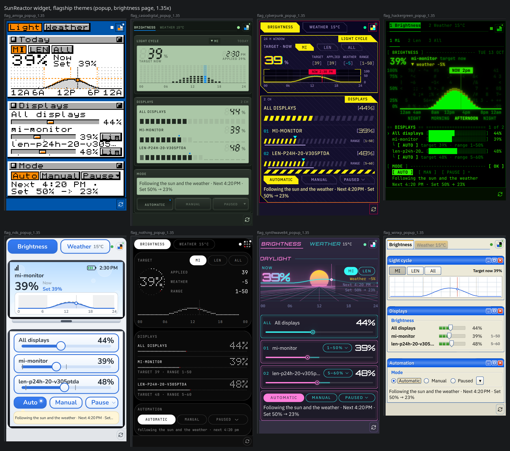
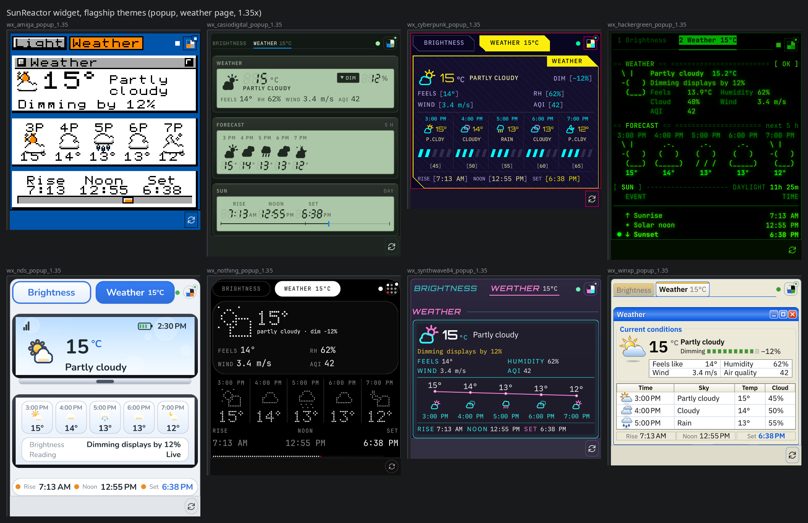

# Theme authoring

A theme is one TOML file. It defines the colours and presentation tokens used by
the terminal UI, by the daemon's IPC (`status.theme`, `get_theme`) and by the
KDE Plasma 6 widget. Built-in themes are compiled in; your own themes are plain
files you can copy, edit and validate without rebuilding anything.

The reference implementation is `src/theme/` (parser and validation in
`file.rs`, lookup in `registry.rs`). The widget-side design is in
`plasma/org.sunreactor.plasma/DESIGN.md`, sections 2 and 4.

## 1. Where themes live

| Source | Location | Notes |
|---|---|---|
| Built-in | embedded in the binaries from `src/theme/builtin/*.toml` | 40 themes, listed in section 6 |
| User | `~/.config/sunreactor/themes/<id>.toml` | the file name must equal `id` |

A user file shadows a built-in with the same `id`. Remove the user file to get
the built-in back.

`tui.theme` in `config.toml` holds a theme id. Lookup accepts an id or any alias,
ignores case, treats `-` and spaces as `_`, and when that is unambiguous also
ignores `_` altogether, so `vfdhifi` finds `vfd_hifi`. Legacy names such as
`workbench` or `dmg` keep working through aliases.

## 2. File format

Every key below is shown with its default or allowed values. Only `id`, `name`,
`family` and the ten palette colours are required (after `extends`, see 2.5).

```toml
id      = "moss_console"        # required; [a-z0-9_]+, max 48 chars, == file stem
name    = "Moss Console"        # required; 1..=64 printable characters
aliases = ["moss"]              # optional; max 16, each [a-z0-9_]+, unique
family  = "terminal"            # required; pixel | instrument | terminal
extends = "gruvbox"             # optional; id or alias of another theme

[palette]                       # every key required, "#rrggbb"
bg               = "#1d2021"
fg               = "#ebdbb2"
accent           = "#b8bb26"
secondary_accent = "#8ec07c"
border_active    = "#d79921"
border_inactive  = "#504945"
text_muted       = "#a89984"
success          = "#b8bb26"
warning          = "#fabd2f"
error            = "#fb4934"

[tui]                           # optional
glyph_style = "rounded"         # rounded | pixel (default rounded)

[widget]                        # optional; every key optional
renderer    = "terminal"        # pixel | vector | terminal
font        = "mono"            # bitmap8 | bitmap_vga | mono | sans | display
pixel_scale = 0                 # 0..=6; 0 = automatic from the device pixel ratio
shades      = ["#1d2021", "#504945", "#a89984", "#ebdbb2"]   # 2..=16, dark to light
density     = "compact"         # compact | comfortable
border      = "line"            # none | line | bevel | inset | double
radius      = 0                 # 0..=24 logical px; ignored by the pixel renderer
dither      = "none"            # none | bayer2 | bayer4
glow        = 0.0               # 0.0..=1.0
modules     = ["telemetry", "curve", "displays", "automation", "weather", "forecast", "suntimes"]
```

### 2.1 Top-level keys

- **`id`** is the theme's identity. It must equal the file stem of a user theme,
  and it is never inherited through `extends`.
- **`name`** is the label shown in the picker and in `theme list`. It may be
  inherited from the `extends` base when omitted.
- **`aliases`** are alternative names. An alias may not equal the theme's own id
  and may not be used by any other theme's id or alias. Aliases are never
  inherited.
- **`family`** selects the widget defaults (2.4). It may be inherited from the
  base when omitted.

### 2.2 `[palette]`

Ten colours, all `#rrggbb` (either case is accepted, output is lowercase):

| Key | Used for |
|---|---|
| `bg` | background of the popup and the terminal UI |
| `fg` | primary text and the strongest shade |
| `accent` | the main highlight (active values, the current selection) |
| `secondary_accent` | second highlight and secondary series |
| `border_active` | focused borders and the active tab |
| `border_inactive` | idle borders, rules and grid lines |
| `text_muted` | labels, captions and units |
| `success`, `warning`, `error` | the status dot: the daemon state (live, paused or manual, offline) |

### 2.3 `[tui]`

- **`glyph_style`**: the digit face of the large brightness numbers on the
  terminal UI's Automation tab: `rounded` (default) or `pixel`. Only the terminal
  UI reads it.

### 2.4 `[widget]` and the family defaults

Keys the file leaves out are filled from the family:

| family | renderer | font | border | radius | dither | glow | density |
|---|---|---|---|---|---|---|---|
| `pixel` | pixel | bitmap8 | line | 0 | bayer4 | 0.0 | compact |
| `instrument` | vector | sans | line | 4 | none | 0.0 | comfortable |
| `terminal` | terminal | mono | line (box drawing) | 0 | none | 0.0 | compact |

Defaults that do not depend on the family:

- `pixel_scale = 0` (automatic)
- `modules` = all seven, in the order shown above
- `shades` = the four colours `bg`, `border_inactive`, `text_muted`, `fg`, sorted
  by luminance (dark to light), when the file gives none

Every key in `[widget]` is validated: unknown keys anywhere in the file are errors.

What each key controls:

- **`renderer`**: how the widget draws the popup. `pixel` builds the art on a
  pixel grid (bitmap glyphs, dithering, `pixel_scale`), `vector` uses ordinary
  shapes and text, `terminal` lays out a character grid like a TUI.
- **`font`**: the text face. `bitmap8` and `bitmap_vga` are pixel fonts and are only
  drawn at their native size; `mono`, `sans` and `display` are vector faces from
  the bundled fonts.
- **`pixel_scale`**: art-pixel size in logical px when the renderer is `pixel`
  (1 to 6). `0` picks a size from the display scale.
- **`shades`**: the dark-to-light tone ramp the widget draws with.
- **`density`**: spacing of the popup rows and modules.
- **`border`**: frame style around modules: `none`, `line`, `bevel`, `inset`, `double`.
- **`radius`**: corner radius of modules and cards (ignored by `pixel`).
- **`dither`**: `none`, `bayer2` or `bayer4`, used by the pixel renderer.
- **`glow`**: phosphor or tube bloom from `0.0` (none) to `1.0`.
- **`modules`**: the popup modules, in order, each at most once, at least one.
  `telemetry` is the status line, `curve` the light cycle, `displays` the
  per-display rows, `automation` the mode and next milestone, `weather`,
  `forecast` and `suntimes` the weather tab. A theme that lists modules for both
  tabs gets the tab bar; otherwise everything shows on one page.

### 2.5 `extends`

`extends = "<id or alias>"` starts from another theme and overrides only what the
file sets:

- palette and `[widget]` merge key by key; `[tui]` merges the same way;
- `name` and `family` are inherited when omitted;
- `id` and `aliases` are never inherited;
- chains are followed up to 8 levels. A cycle, an unknown base, or a chain that
  is too deep is an error that names the chain.

`sunreactorctl theme export <id>` writes a standalone file (no `extends`) that
you can use as the starting point instead.

### 2.6 Limits and errors

| Limit | Value |
|---|---|
| file size | 64 KiB |
| `name` | 1 to 64 printable characters |
| `id` and each alias | `[a-z0-9_]+`, id at most 48 characters |
| `aliases` | at most 16 |
| `pixel_scale` | 0 to 6 |
| `radius` | 0 to 24 |
| `glow` | 0.0 to 1.0 |
| `shades` | 2 to 16 colours |
| `extends` depth | 8 |

Validation reports every problem in one pass, with the file name and the key.
For example:

```text
theme file .../themes/broken_moss.toml is invalid:
  - palette.bg: `#1d202g` is not a #rrggbb colour
```

## 3. Worked example: a custom theme

This theme starts from Gruvbox, changes three colours, switches the terminal UI
to pixel digits and leaves the status line out of the popup. Save it as
`~/.config/sunreactor/themes/moss_console.toml`:

```toml
id      = "moss_console"
name    = "Moss Console"
aliases = ["moss"]
extends = "gruvbox"      # inherit the palette and [widget] keys of gruvbox
family  = "terminal"     # family defaults fill any [widget] key neither file sets

[palette]
bg               = "#1d2021"
accent           = "#b8bb26"
secondary_accent = "#8ec07c"

[tui]
glyph_style = "pixel"

[widget]
glow    = 0.15
modules = ["curve", "displays", "automation", "weather", "forecast", "suntimes"]
```

Then check it and use it:

```bash
sunreactorctl theme validate ~/.config/sunreactor/themes/moss_console.toml
sunreactorctl theme show moss                # resolved palette and widget tokens
sunreactorctl theme set moss                 # writes tui.theme and reloads the daemon
```

`theme show` prints the colours after `extends` has been applied, so it is the
quickest way to see what a theme really resolves to.

## 4. Using themes

### 4.1 `sunreactorctl theme`

| Command | What it does |
|---|---|
| `theme list [--json]` | Every theme with id, family, source and name. The configured `tui.theme` is marked `*`. `--json` prints the daemon-shaped summaries. |
| `theme show <id> [--json]` | The resolved theme: source, `extends`, palette and every `widget` token, with family defaults applied. |
| `theme set <id>` | Writes the canonical id into `tui.theme` in `config.toml`, then asks a running daemon to reload. Works offline too; only the save happens. |
| `theme validate [file]` | With no argument, checks every user theme file and reports broken ones. With a file, checks that file against the built-ins and the user directory (so `extends` and alias clashes are caught). Exits non-zero on any error. |
| `theme export <id>` | Prints a complete standalone theme with comments on how to make it your own. |

Unknown ids fail with the nearest matches. For example,
`sunreactorctl theme show dracla` suggests `dracula`.

### 4.2 When a change takes effect

- **Daemon**: it reads the user theme directory when it starts and again on every
  `reload_config` (`sunreactorctl reload-config`, `theme set`, or a save from the
  terminal UI). A broken file is logged and skipped; the other themes still load.
- **Terminal UI**: it loads the registry when it starts. After adding or editing
  a user theme, restart `sunreactorctl tui`.
- **Plasma widget**: it reads the theme from the daemon's `status.theme` and
  refreshes it with the daemon. A pinned theme is fetched again when the popup
  opens, on config reload, and every 10 minutes.

### 4.3 If the configured theme cannot be used

The daemon never stops automatic brightness because of a theme. If `tui.theme`
names an unknown theme, or the user file with that id is broken:

- the daemon falls back to the built-in with the same id if there is one,
  otherwise to `amber`;
- `sunreactorctl status` shows `theme_warning` with the reason;
- `sunreactorctl config validate` and `doctor` report the same problem as an
  error and exit non-zero.

### 4.4 IPC shapes (for scripts)

| Request | Response |
|---|---|
| `{"version":1,"request":"list_themes"}` | `{"version":1,"response":"themes","themes":[...]}`: id, name, family and palette summary per theme |
| `{"version":1,"request":"get_theme","id":"nord"}` | `{"version":1,"response":"theme","theme":{...}}`: the full resolved theme (palette, widget tokens, source) |
| `{"version":1,"request":"day_curve","monitor_id":null}` | `{"version":1,"response":"day_curve",...}`: the day's policy curve used by the widget's light cycle |

`status` gains `theme` (palette and widget tokens) and `theme_warning`. Both are
optional fields, so older clients keep working. An unknown id to `get_theme`
returns `invalid_request` with the reason in the message.

## 5. How the Plasma widget uses themes

The widget has a theme source and a set of overrides. It never reads the
config file itself; the daemon is the single source of truth.

### 5.1 Follow or pin

- **Follow** (`themeMode = "follow"`, the default): the widget shows the theme
  the terminal app saved, which is the daemon's `status.theme`. Changing the
  theme in the terminal changes the widget.
- **Pin** (`themeMode = "pinned"`, `pinnedTheme = "<id>"`): the widget shows that
  theme whatever the terminal uses, fetched with `get_theme`. A missing theme or
  an older daemon makes the widget fall back to following, and the settings page
  says why.

The theme button at the right end of the tab row shows a swatch of the active
theme, a dot while following, a lock while pinned, and a warning when the daemon
fell back.

### 5.2 Overrides

These settings change the look without changing the theme file:

| Setting | Values | Effect |
|---|---|---|
| `accentOverride` | `#rrggbb` or empty | replaces the theme's accent |
| `densityOverride` | `compact`, `comfortable` or empty | replaces `density` |
| `pixelScale` | 0 to 6 (0 = theme / automatic) | art-pixel size for the pixel renderer |
| `rendererOverride` | `pixel`, `vector`, `terminal` or empty | replaces `renderer` |
| `moduleOrder` | module ids in display order (empty = theme order) | reorders the popup |
| `hiddenModules` | module ids (default: `telemetry`) | hides modules whatever the order |

`telemetry` starts hidden because the status lamp in the tab row stands in for
it. Show it from the settings if you want the full status line.

### 5.3 Weather icon styles

The widget's `weatherIconStyle` chooses the weather icon set for both the panel
and the popup:

| Value | Look |
|---|---|
| `auto` (default) | the theme's own weather art, such as Wii channel art, DS cartoon art or Luna icons for XP |
| `modern` | full-colour icons that look the same in every theme |
| `line` | outline icons |
| `solid` | filled icons |
| `pixel` | 16 px pixel-art sprites |

## 6. Built-in themes and flagship skins

The widget picks its layout by theme id first, then by renderer. Three cases
exist:

- **Flagship skin**: the theme has its own folder under
  `plasma/org.sunreactor.plasma/package/contents/ui/skins/`, with its own
  telemetry, light cycle, displays, automation, weather, forecast and sun-times
  modules, and often its own tabs and weather icons. There are 12.
- **Instrument skin, own flavour**: the theme uses the shared instrument skin and
  picks its identity (VFD, Nixie, scope, ThinkPad, Braun) from the id and tokens.
- **Family default**: the theme uses the skin of its renderer (`skins/pixel`,
  `skins/terminal`, or the instrument skin for `vector`).

The registry contains 40 built-in themes:

| id | name | family | renderer | widget skin |
|---|---|---|---|---|
| `amber` | Amber | instrument | vector | family default |
| `amiga` | Amiga | pixel | pixel | flagship skin |
| `ayudark` | Ayu Dark | terminal | terminal | family default |
| `ayumirage` | Ayu Mirage | terminal | terminal | family default |
| `braun` | Braun | instrument | vector | instrument skin, own flavour |
| `casiodigital` | Casio Digital | instrument | vector | flagship skin |
| `catppuccinmocha` | Catppuccin Mocha | terminal | terminal | family default |
| `classicmacintosh` | Classic Macintosh | pixel | pixel | family default |
| `commodore64` | Commodore 64 | pixel | pixel | flagship skin |
| `cyberpunk` | Cyberpunk | instrument | vector | flagship skin |
| `dracula` | Dracula | terminal | terminal | family default |
| `everforest` | Everforest | terminal | terminal | family default |
| `grayscale` | Grayscale | instrument | vector | family default |
| `gruvbox` | Gruvbox | terminal | terminal | family default |
| `hackergreen` | Hacker Green | terminal | terminal | flagship skin |
| `handheld` | Handheld | pixel | pixel | family default |
| `kanagawa` | Kanagawa | terminal | terminal | family default |
| `macos` | macOS | instrument | vector | flagship skin |
| `materialocean` | Material Ocean | terminal | terminal | family default |
| `monokai` | Monokai | terminal | terminal | family default |
| `nds` | Nintendo DS | instrument | vector | flagship skin |
| `nightowl` | Night Owl | terminal | terminal | family default |
| `nixie` | Nixie | instrument | vector | instrument skin, own flavour |
| `nord` | Nord | terminal | terminal | family default |
| `nothing` | Nothing | instrument | vector | flagship skin |
| `onedark` | One Dark | terminal | terminal | family default |
| `oscilloscope` | Oscilloscope | instrument | vector | instrument skin, own flavour |
| `phosphorblue` | Phosphor Blue | instrument | vector | family default |
| `ps3` | PlayStation 3 | instrument | vector | flagship skin |
| `rosepine` | Rosé Pine | terminal | terminal | family default |
| `solarizeddark` | Solarized Dark | terminal | terminal | family default |
| `synthwave84` | Synthwave '84 | instrument | vector | flagship skin |
| `terminal` | Terminal | terminal | terminal | family default |
| `thinkpad` | ThinkPad | instrument | vector | instrument skin, own flavour |
| `tokyonight` | Tokyo Night | terminal | terminal | family default |
| `unixworkstation` | UNIX Workstation | instrument | vector | family default |
| `vfd_hifi` | VFD Hi-Fi | instrument | vector | instrument skin, own flavour |
| `wii` | Nintendo Wii | instrument | vector | flagship skin |
| `winxp` | Windows XP | instrument | vector | flagship skin |
| `zenburn` | Zenburn | terminal | terminal | family default |

Summary: 12 flagship skins (Amiga, Casio Digital, Commodore 64, Cyberpunk, Hacker
Green, macOS, Nintendo DS, Nothing, PlayStation 3, Synthwave '84, Nintendo Wii,
Windows XP), 5 instrument flavours (Braun, Nixie, Oscilloscope, ThinkPad, VFD
Hi-Fi), and 23 family defaults.

## 7. Screenshots

Captured headless at 1.35x device pixel ratio with the fake daemon in the
widget's QA harness (`plasma/org.sunreactor.plasma/tools/shot.sh`):

| Image | What it shows |
|---|---|
|  | The popup's brightness page for Amiga, Casio Digital, Cyberpunk, Hacker Green, Nintendo DS, Nothing, Synthwave '84 and Windows XP |
|  | The weather page of the same eight themes, each with its own weather art |

## 8. Troubleshooting

- **`unknown theme` with a suggestion**: check the spelling against
  `sunreactorctl theme list`. Ids are lowercase with underscores.
- **`theme file ... is invalid`**: run `sunreactorctl theme validate <file>`. The
  message names the key; `id` must match the file name exactly.
- **The widget says "not found" for a pinned theme**: the id does not exist in
  the daemon's registry. Fix the id or the user file, then reload.
- **The widget shows the wrong layout for a new theme**: the skin is chosen by id
  and then by renderer. A family default needs no code; a flagship skin needs the
  skin folder above.
- **A terminal-UI change does not appear**: restart `sunreactorctl tui`.
